<a href="https://pikeras72.github.io">
  <picture>
    <source media="(prefers-color-scheme: dark)" srcset="imagenes/cartel-oscuro.svg">
    
  </picture>
</a>

 

<picture>
  <source media="(prefers-color-scheme: dark)" srcset="imagenes/estadisticas-oscuro.svg">
  
</picture>
